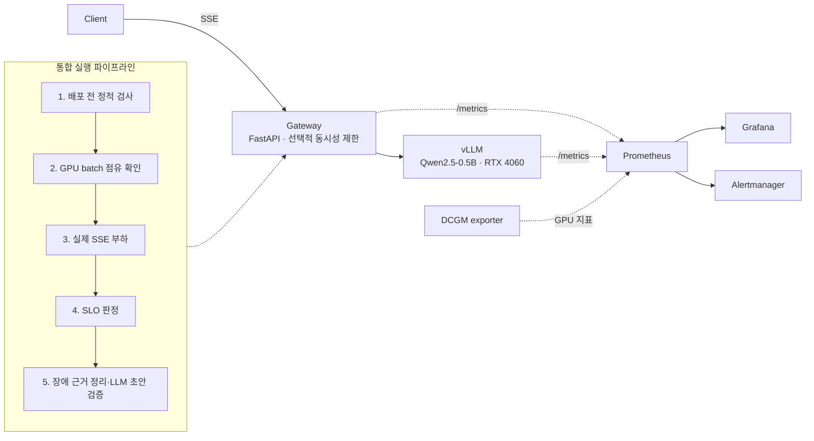

# KubeLLM-Ops

**GPU 한 장(RTX 4060 8GB)에서 vLLM 서빙을 운영할 때 생기는 문제를 직접 만들고, 관측하고, 복구한 기록입니다.**
배포 전 검사부터 부하 제한, SLO 판정, 장애 분석까지 한 번의 실행으로 연결했습니다.

[](https://github.com/eunsu7997/kubellm-ops-public/actions/workflows/ci.yml)

## 해결하려는 문제

GPU가 한 장뿐인 LLM 서버는 요청이 몰리면 바로 느려지거나 실패합니다. 그런데 `/health`는 계속 200을 돌려줄 수 있어서 "살아 있는데 쓸 수 없는" 상태를 놓치기 쉽습니다.
이 프로젝트는 세 가지를 확인합니다.

1. 서빙이 실제로 응답하는지 어떻게 판단할 것인가 (liveness와 readiness 분리, 실제 추론 기반 readiness)
2. 과부하를 어떻게 막고, 막았을 때 사용자 경험은 어떻게 달라지는가 (admission 제어와 재시도)
3. 성능을 어떻게 공정하게 판정할 것인가 (실패한 요청을 분모에 포함한 SLO 계산)

## 구조



| 구성 요소 | 위치 | 역할 |
| --- | --- | --- |
| Gateway | `gateway/` | OpenAI 호환 프록시. SSE 중계, 오류 분류, 지표, 선택적 동시성 제한(429 + `Retry-After`) |
| Mock backend | `mock-backend/` | GPU 없이 API·장애 경로를 시험하는 CPU echo 서버 |
| Kubernetes 매니페스트 | `k8s/` | Gateway·vLLM·DCGM. `k8s/validation/`은 WSL k3s에서 실제로 적용한 버전 |
| 모니터링 | `monitoring/` | Prometheus 규칙(단위 테스트 포함), Alertmanager, Grafana 대시보드 |
| 부하·SLO 도구 | `scripts/load-test/` | open-loop 부하, 동시성 sweep, SLO 평가기 |
| 운영 실험 | `scripts/ops/`, `scripts/failure-tests/` | 장애 주입·복구·안전 하네스(GPU 온도·VRAM 감시) |

## 핵심 결과

Qwen2.5-0.5B-Instruct, vLLM, RTX 4060, 2026-10-22 실행 (`d93e1bff…`). 목표는 실행 전에 고정했습니다: 전체 SSE E2E P99 ≤ 2.5초, 최종 오류율 0%.

| 지표 | 재시도 없음 | 429만 제한 재시도 (최대 2회) |
| --- | ---: | ---: |
| 최종 완료 / 요청 | 30 / 40 | 40 / 40 |
| 최종 오류율 | 25% | 0% |
| 성공 요청 E2E P99 (재시도 대기 포함) | 0.65초 | 1.34초 |
| 목표 판정 | FAIL | PASS |

같은 조건을 20회 반복한 320요청 비교에서도 성공은 120/160 → 160/160이었고, 그 대가로 HTTP 시도가 1.25배 늘었습니다. 1초 TTFT 달성률은 두 정책 모두 75%로 같았습니다.
즉 **재시도는 성공률을 올리지만 지연을 늘립니다.** 실패를 분모에서 빼면 재시도 없는 쪽이 더 빨라 보이는 함정이 있어, 오류율과 지연을 함께 판정했습니다.

자세한 내용: [최신 결과](docs/RESULTS.md) · [실행 증거](evidence/public-integration-20261023/README.md)

## 바로 실행해 보기 (GPU 없이)

```bash
docker compose up -d --build
curl -s localhost:8000/readyz
curl -s localhost:8000/v1/chat/completions \
  -H 'content-type: application/json' \
  -d '{"messages":[{"role":"user","content":"hello"}]}'
# Prometheus http://localhost:9090 · Grafana http://localhost:3000
```

테스트와 lint:

```bash
python -m venv .venv && . .venv/bin/activate   # Windows: .\.venv\Scripts\activate
pip install -r requirements-dev.txt
pytest -q && ruff check .
```

실제 GPU 모델 실행은 [로컬 실행 가이드](docs/RUN-LOCAL.md)와 [Docker GPU 보안 구성](docs/docker-gpu-security-migration.md)을 참고하세요.

## 검증 범위

| 항목 | 상태 | 근거 |
| --- | --- | --- |
| Docker에서 vLLM 실제 추론·SSE·복구 | 검증 | [운영 마감 기록](docs/OPERATIONAL-CLOSURE.md) |
| WSL k3s에서 GPU Pod·vLLM·Gateway·DCGM 수집 | 검증 | [Kubernetes 실측](docs/KUBERNETES-LIVE-VALIDATION.md) |
| Pod 삭제·모델 로드 실패·GPU 부족 Pending 복구 | 검증 | 같은 문서, `scripts/failure-tests/` |
| 120분 장시간 관측 | 부분 실패(기록 보존) | [야간 관측](docs/reports/2026-10-22-overnight-observation.md) |
| Gateway 단위·계약 테스트, 경보 규칙 테스트 | CI에서 매 push | `tests/`, `monitoring/operations/alerts.test.yml` |
| 동시성 sweep으로 찾은 포화 지점 | 미실행 (스크립트 준비) | `scripts/load-test/concurrency_sweep.py` |
| 다중 GPU, 자동 확장(KEDA/HPA), production 운영 | 범위 밖 | — |

## 한계와 다음 단계

- 0.5B 모델과 GPU 한 장, 작은 표본에서 얻은 결과입니다. 일반적인 성능 개선 주장이 아닙니다.
- 다음 실험: 동시성을 1→32로 올리며 처리량–지연 곡선을 그리고, 꺾이는 지점을 근거로 Gateway 동시성 제한값을 정합니다. 더 큰 모델(1.5B~3B, 7B AWQ)로 VRAM과 KV cache 압박을 재현합니다.
- 비공개 원본 저장소의 원시 로그는 개인정보 보호를 위해 일부만 공개했습니다. [공개 범위](docs/reports/2026-10-23-publication-review.md)

## 라이선스

[MIT](LICENSE)
